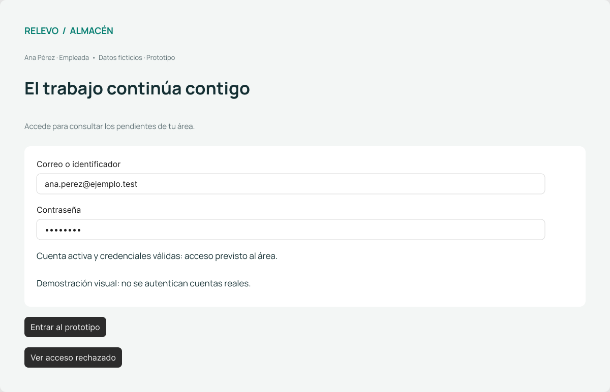
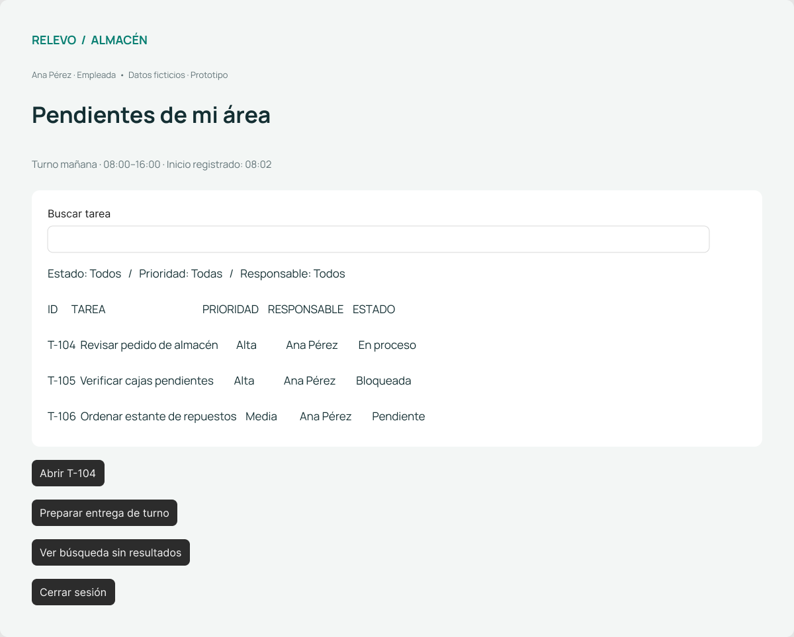
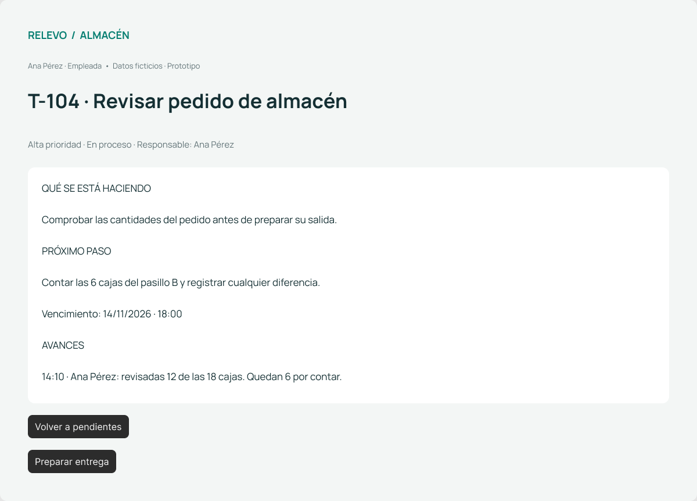
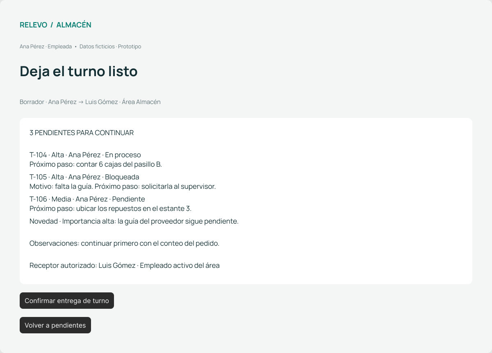
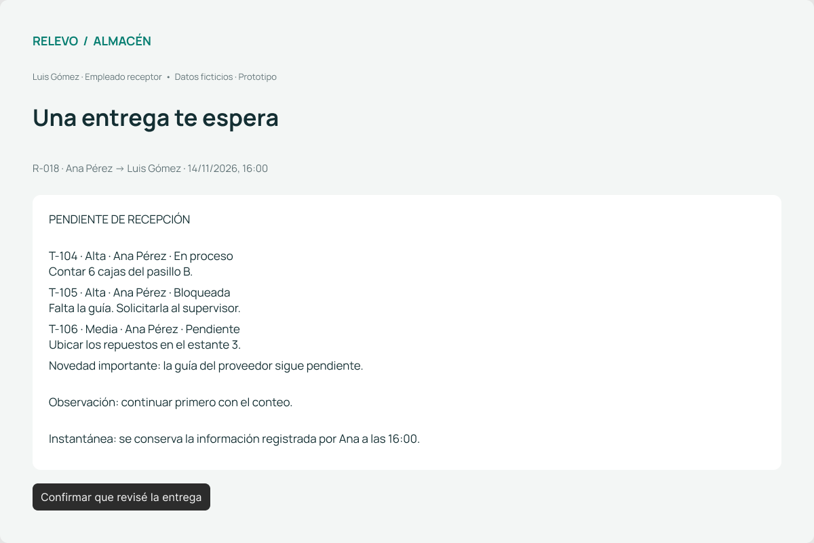
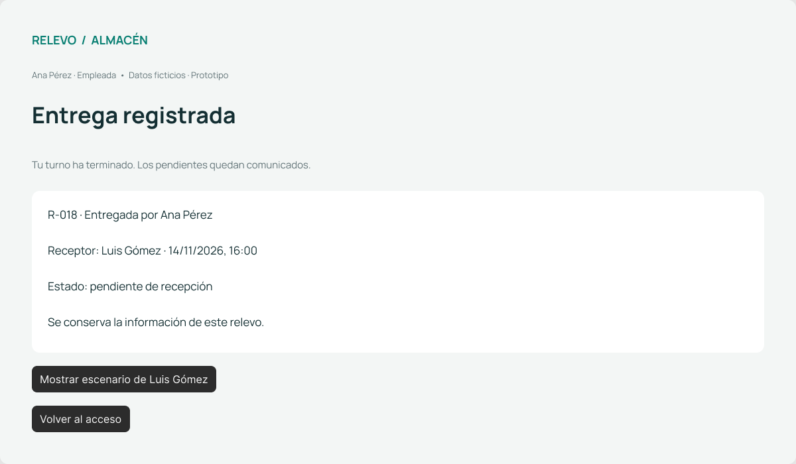
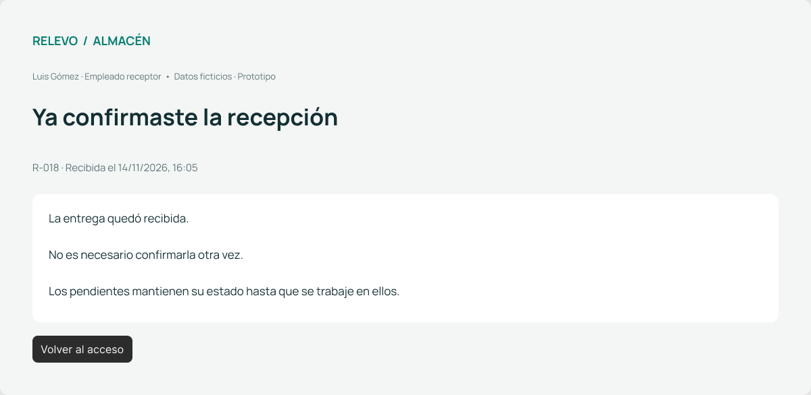
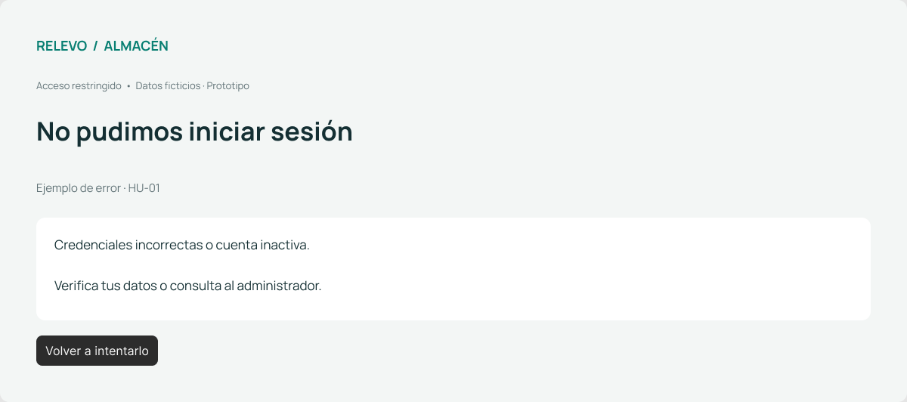
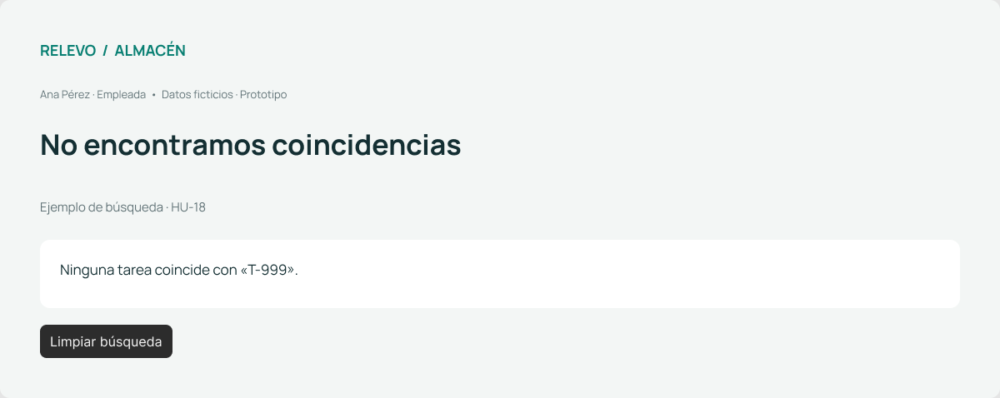

# Mockups de Relevo

Relevo busca conservar avances y próximos pasos entre turnos de trabajo. Este documento presenta cinco pantallas principales y cuatro vistas complementarias. Los datos son ficticios.

## Lista de pantallas

1. Acceso
2. Pendientes del área
3. Detalle de tarea
4. Entrega de turno
5. Recepción del relevo
6. Entrega registrada
7. Recepción confirmada
8. Acceso rechazado
9. Búsqueda sin resultados

## 1 Acceso

HU-01: acceso y ejemplo de rechazo.

## 2 Pendientes del área

HU-02, HU-10, HU-12, HU-15, HU-18, HU-19: turno, listado y controles de búsqueda representados visualmente.

## 3 Detalle de tarea

HU-16 y HU-27: contexto, próximo paso y avances.

## 4 Entrega de turno

HU-21, HU-29, HU-30, HU-31: tareas, bloqueo, novedades y receptor.

## 5 Recepción del relevo

HU-32, HU-33, HU-34: recepción de entrega y confirmación.

## 6 Entrega registrada

Confirmación simulada de entrega con recepción pendiente.

## 7 Recepción confirmada

Confirmación simulada de recepción sin botón de repetición.

## 8 Acceso rechazado

Error previsto de credenciales o cuenta inactiva.

## 9 Búsqueda sin resultados

Ejemplo de búsqueda sin coincidencias.

## Alcance

16 enlaces conectan los nueve frames. Acceso → Pendientes → Detalle → Entrega → Confirmación. Después se muestra el escenario del receptor, que revisa y confirma. Campos, filtros, permisos, autenticación y almacenamiento no están implementados; la cobertura de historias es visual y parcial. Los 35 requerimientos siguen pendientes de implementación.
